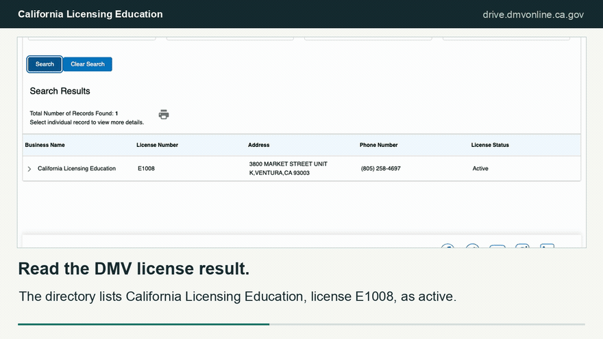

# California Ticket Decoder

Look up 49 source-linked 2026 California ticket schedule examples offline in Python or Node. Each result gives the county, Vehicle Code, scenario, amount in cents, source and page. Coverage varies by offense. For example, the only reviewed stop-sign row is Santa Barbara. Your court determines the balance, eligibility and deadline for your case.

## Use it in a browser

[Filter the schedule references](https://huggingface.co/spaces/NathanRoll/california-traffic-ticket-decoder) or [run the audit in Google Colab](https://colab.research.google.com/github/Nathan-Roll1/california-ticket-decoder/blob/main/notebooks/ticket-schedule-audit.ipynb). The notebook verifies the released Python wheel, shows the source pages for a selected ticket and reconciles all 49 rows in integer cents. The [Observable notebook source](notebooks/county-fees.html) compares base fines, state penalties and separately sourced court traffic-school fees for the same speeding example.

The [school cost guide](https://traffic.californialicensingeducation.com/traffic-school-cost/) explains how school tuition differs from the scheduled fine. For a San Diego citation, the [San Diego traffic school guide](https://traffic.californialicensingeducation.com/san-diego-traffic-school/) covers court permission and completion.

## Install from a release

Download a build and the SHA256SUMS.txt file from the [v0.1.0 decoder release](https://github.com/Nathan-Roll1/california-ticket-decoder/releases/tag/v0.1.0). Verify the digest of the downloaded file before installation.

In a Python virtual environment:

    python -m pip install --no-index ./california_ticket_decoder-0.1.0-py3-none-any.whl
    california-ticket-decoder get "Santa Barbara" "22450(a)"

With Node 18 or newer, in a local project:

    npm install --offline ./california-ticket-decoder-0.1.0.tgz
    npx --offline california-ticket-decoder list

## Directory price notes

The separate Chrome extension shows seven dated school offers and identifies promotional prices and optional services. CLE sells one of the compared courses. Open the popup beside a directory PDF, or apply the notes to supported HTML pages. It uses temporary active-tab access and runs on demand. See the [installation and privacy notes](extension/README.txt).

## Compare an advertised fee with a DMV result

The California DMV directory supplies the license record. California Licensing Education supplies the local fee note and sells the course shown. The observed school fee was checked November 16, 2026. Court fees and fines are separate. [Official DMV directory](https://www.dmv.ca.gov/portal/vehicle-industry-services/occupational-licensing/occupational-license-lookup/traffic-school-list/) · [Offer sources](https://traffic.californialicensingeducation.com/how-to-choose-traffic-school/#provider-offers)

## Sources and license

California Licensing Education maintains the [2026 dataset](https://github.com/Nathan-Roll1/california-traffic-ticket-and-tvs-fees-2026) and the [web tools](https://traffic.californialicensingeducation.com/tools/?utm_source=github&utm_medium=referral&utm_campaign=ticket_decoder). To cite the 49 examples from six counties used in this release, use the [archived dataset and version DOI](https://doi.org/10.5281/zenodo.24326258). Verify case-specific questions with the issuing court. The code uses the MIT license. The original dataset curation and annotations use CC BY 4.0. Third-party source documents retain their own terms.
